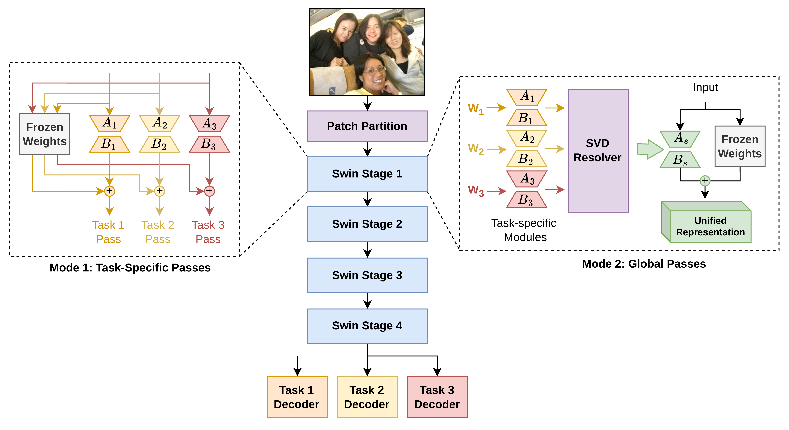

# CRLoMTL: Conflict-Resolution through Low-rank Matrices for Multi-Task Learning

Ahmed Agiza\*, Tasneem Shaffee\*, Rahil Badkul, Sherief Reda

Brown University. \*Equal contribution.

[](https://arxiv.org/abs/2610.36337)

Official PyTorch implementation of our BMVC 2026 paper.

<p align="center">
  
</p>

Overview of CRLoMTL. Each task learns its own LoRA matrices on a frozen backbone (left). The SVD resolver merges them into one shared update, trained with the loss of all tasks (right). After training, this update is merged into the backbone, so the final model has no extra layers.

## Abstract

Multi-task learning (MTL) improves model efficiency by sharing representations across related vision tasks, but it often suffers from negative transfer when task updates interfere with one another. Existing conflict-mitigation methods typically operate in gradient space, requiring explicit task-gradient manipulation and additional optimization steps. We propose *Conflict-Resolution through Low-Rank Matrices for Multi-Task Learning (CRLoMTL)*, a parameter-efficient framework that mitigates task interference in the low-rank parameter-update space. CRLoMTL learns task-specific LoRA updates through task-specific passes, where each task updates its own low-rank matrices, and integrates these updates through global shared-subspace fusion. Specifically, we introduce a shared-subspace resolver based on singular value decomposition (SVD), referred to as the SVD resolver, which extracts a common low-dimensional orthonormal basis across task adapters and projects task updates into this shared space before merging them into a single deployment-time update. The resulting update can be folded into the backbone, preserving the inference structure of the original model without additional runtime branches. Experiments with Swin Transformer backbones on PASCAL-Context, NYUD-v2, and CelebA show that CRLoMTL achieves a favorable accuracy-parameter trade-off, improving over single-task baselines by up to 2.77% on PASCAL-Context, 5.03% on NYUD-v2, and 3.50% on CelebA, while training only a small fraction of the parameters used by single-task models.

## What CRLoMTL does

CRLoMTL is a training method for multi-task models that share one Swin Transformer backbone and have one decoder per task.

- **Input:** a multi-task dataset, the list of tasks, and a vanilla MTL model trained on these tasks (step 1 in [Training](#training)).
- **Training:** the backbone stays frozen. Each task trains its own LoRA matrices, and the SVD resolver merges them into one shared update that is trained with the loss of all tasks.
- **Output:** a multi-task model with the merged update folded into the backbone weights ([Merged checkpoint](#merged-checkpoint)). It has the same architecture, size and speed as the original Swin MTL model. For Swin-Tiny on PASCAL-Context, only 4.39M parameters are trained.

You can change the dataset and tasks, the Swin size (Tiny and Small configs are provided), the LoRA rank and scaling (`--lora_r`, `--lora_alpha`) and how the task LoRAs are merged (`--crlomtl_resolver`). With many tasks, tasks can also share one LoRA per group, as we do for the 40 CelebA attributes (`CELEBA_GROUPS` in `config.py`). See [Using CRLoMTL on your own tasks](#using-crlomtl-on-your-own-tasks).

## Setup

We tested the code with Python 3.10, PyTorch 2.7.1 (CUDA 12.6) and torchvision 0.22.1.

```bash
git clone https://github.com/scale-lab/CRLoMTL.git
cd CRLoMTL

conda create -n crlomtl python=3.10 -y
conda activate crlomtl

# Install PyTorch for your CUDA version first, see https://pytorch.org/get-started/locally/
pip install torch==2.7.1 torchvision==0.22.1 --index-url https://download.pytorch.org/whl/cu126

pip install -r requirements.txt
```

### Pretrained backbones

Download the ImageNet-1K Swin weights from the [Swin Transformer](https://github.com/microsoft/Swin-Transformer) release:

```bash
mkdir -p pretrained
wget -P pretrained https://github.com/SwinTransformer/storage/releases/download/v1.0.0/swin_tiny_patch4_window7_224.pth
wget -P pretrained https://github.com/SwinTransformer/storage/releases/download/v1.0.0/swin_small_patch4_window7_224.pth
```

### Datasets

| Dataset | Tasks | Download |
|---|---|---|
| PASCAL-Context | semseg, human_parts, normals, sal | [PASCAL_MT.tgz](https://data.vision.ee.ethz.ch/kmaninis/share/MTL/PASCAL_MT.tgz) |
| NYUD-v2 | semseg, depth | [NYUD_MT.tgz](https://drive.google.com/file/d/14EAEMXmd3zs2hIMY63UhHPSFPDAkiTzw/view?usp=sharing) |
| CelebA | 40 binary attributes | [CelebA](https://mmlab.ie.cuhk.edu.hk/projects/CelebA.html) (Align&Cropped images) |

Extract PASCAL and NYUD and pass the extracted folder with `--data_path`. CelebA should keep the layout of the official release:

```
celeba/
├── Anno/list_attr_celeba.txt
├── Eval/list_eval_partition.txt
└── Img/img_align_celeba/*.jpg
```

## Training

All runs go through `train.py`. The config file (`--cfg`) sets the method and model, and command-line arguments override it. Logs and checkpoints are written to `--output`. Vanilla MTL and the baselines train for 500 epochs and the CRLoMTL configs for 350. The model is evaluated every 25 epochs.

The configs and commands in this README follow the setup of the paper, and running them gives results close to the reported ones. The numbers can still differ slightly between runs, because some GPU operations are not deterministic.

All models use a Swin Transformer backbone pre-trained on ImageNet-1K. To stabilize training, we first train a vanilla MTL model with the standard MTL loss (step 1). CRLoMTL then starts from this model, freezes the backbone, and trains the task-specific LoRA matrices (step 2).

**1. Vanilla MTL on PASCAL-Context (Swin-Tiny)**

```bash
python train.py --cfg configs/swin/swin_tiny_mtl.yaml \
  --dataset PASCALContext --data_path <path>/PASCAL_MT \
  --resume pretrained/swin_tiny_patch4_window7_224.pth --resume_backbone \
  --batch_size 32 --tag mtl_tiny --output output/mtl_tiny
```

**2. CRLoMTL on PASCAL-Context (Swin-Tiny)**

```bash
python train.py --cfg configs/swin_tiny_crlomtl_ss.yaml \
  --dataset PASCALContext --data_path <path>/PASCAL_MT \
  --resume <MTL checkpoint from step 1> \
  --batch_size 32 --tag crlomtl_tiny --output output/crlomtl_tiny
```

For Swin-Small, use `configs/swin/swin_small_mtl.yaml` and `configs/swin_small_crlomtl_ss.yaml` with `swin_small_patch4_window7_224.pth`.

**NYUD-v2**

Use the same two steps with `--dataset NYUD --data_path <path>/NYUD_MT --tasks semseg,depth`.

**CelebA**

```bash
# vanilla MTL
python train.py --cfg configs/swin_tiny_celeba_multi.yaml \
  --dataset CelebA --data_path <path>/celeba \
  --resume pretrained/swin_tiny_patch4_window7_224.pth --resume_backbone \
  --tag celeba_mtl --output output/celeba_mtl

# CRLoMTL with LoRA shared inside 7 attribute groups
python train.py --cfg configs/swin_tiny_celeba_crlomtl.yaml \
  --dataset CelebA --data_path <path>/celeba \
  --resume <CelebA MTL checkpoint> \
  --tag celeba_crlomtl --output output/celeba_crlomtl
```

### Baselines

The gradient and loss-weighting baselines in the paper use the vanilla MTL config with a different `--method`:

```bash
python train.py --cfg configs/swin/swin_tiny_mtl.yaml --method pcgrad \
  --dataset PASCALContext --data_path <path>/PASCAL_MT \
  --resume pretrained/swin_tiny_patch4_window7_224.pth --resume_backbone \
  --batch_size 32 --tag pcgrad --output output/pcgrad
```

Supported values: `multi` (vanilla MTL), `pcgrad`, `cagrad`, `nashmtl`, `mgda`, `imtl`, `famo`, `fairgrad`, `go4align`, `consmtl`, `uw`, `ls` and `mti` (MTI-Net).

For MTLoRA and KnOTS, please use the official code: [MTLoRA](https://github.com/scale-lab/MTLoRA) and [KnOTS](https://github.com/gstoica27/KnOTS).

## Evaluation

Add `--eval` and point `--resume` to a checkpoint:

```bash
python train.py --cfg configs/swin_tiny_crlomtl_ss.yaml \
  --dataset PASCALContext --data_path <path>/PASCAL_MT \
  --resume output/crlomtl_tiny/<run>/ckpt_epoch_<N>.pth --eval
```

The log reports the metric of every task and Δm, the average relative improvement over the single-task models. Single-task reference numbers are in `analysis_utils/single_task_performance.json` (PASCAL-Context) and `analysis_utils/single_task_nyud.json` (NYUD-v2).

### Merged checkpoint

After training, the fused LoRA update can be folded into the backbone weights. The merged model has the same size and speed as the plain Swin model:

```bash
python export_merged_checkpoint.py --cfg configs/swin_tiny_crlomtl_ss.yaml \
  --dataset PASCALContext --data_path <path>/PASCAL_MT \
  --resume <CRLoMTL checkpoint> --output output/crlomtl_tiny_merged
```

This writes `ckpt_last_merged.pth` to the output folder.

## Using CRLoMTL on your own tasks

The code is implemented and evaluated with Swin Transformer backbones. To run CRLoMTL on a new multi-task dataset:

1. **Dataset.** Write a dataset class that returns a dict with `image` and one target per task, like `NYUD_MT` and `PASCALContext` in `data/mtl_dataset.py`. Add it to `get_mtl_train_dataset`, `get_mtl_val_dataset` and `get_transformations` in the same file. Then add a loader function in `data/build_mtl_dataset.py` and register it in `DATASETS_LOADER` in `setup/build_data.py`. Its name can then be passed to `--dataset`.
2. **Tasks.** The existing tasks (`semseg`, `human_parts`, `sal`, `normals`, `edge`, `depth`) can be reused. For `semseg` and `human_parts`, set the number of classes of your dataset in `get_tasks_config` (`data/mtl_dataset.py`) and in the meter in `evaluation/`. For a new task, set its number of output channels in `get_tasks_config`, its loss in `get_loss` (`mtl_loss_schemes.py`) and its loss weight in `all_loss_weights` (`config.py`). The model adds an HRNet-style decoder head for every task.
3. **Evaluation.** For a new task, add its metric in `get_single_task_meter` (`evaluation/evaluate_utils.py`). To report Δm, save your single-task results in a JSON file like `analysis_utils/single_task_performance.json`, add it to `SINGLE_TASK_FILES` and add the task to `calculate_multi_task_performance` in `analysis_utils/metrics.py`.
4. **Training.** Run the vanilla MTL step and then the CRLoMTL step from [Training](#training) with `--dataset <name> --tasks <task1,task2,...>`, and export the merged checkpoint as in [Merged checkpoint](#merged-checkpoint).

To train on a subset of the existing tasks, only step 4 is needed, for example `--dataset PASCALContext --tasks semseg,normals`.

## Arguments

Most settings live in the YAML config. These are the arguments you will use most often:

| Argument | Description |
|---|---|
| `--cfg` | Path to the YAML config file. |
| `--opts KEY VALUE ...` | Override any config entry, e.g. `--opts TRAIN.BASE_LR 1e-4`. |
| `--method` | Training method. `crlomtl` for our method, otherwise one of the baselines above. |
| `--model` | Model type: `swin` for dense prediction, `swin_celeba` for CelebA. |
| `--dataset` | `PASCALContext`, `NYUD` or `CelebA`. |
| `--data_path` | Dataset folder. |
| `--tasks` | Comma-separated tasks to train, e.g. `semseg,depth`. Default: all tasks of the dataset. |
| `--batch_size` | Training batch size (default 32). |
| `--eval_batch_size` | Evaluation batch size. |
| `--epochs` | Number of training epochs (default 500). |
| `--lr` | Base learning rate. |
| `--seed` | Random seed. |
| `--lora_r` | LoRA rank (8 in the paper). |
| `--lora_alpha` | LoRA scaling factor (16 in the paper). |
| `--lora_dropout` | Dropout on the LoRA branch. |
| `--crlomtl_mode` | CRLoMTL schedule. `alternating_with_interm` runs the task-specific passes followed by the global pass (the paper setting). |
| `--crlomtl_resolver` | How task LoRAs are fused in the global pass. `shared_subspace` is the SVD resolver from the paper, `mean` is plain averaging. |
| `--resume` | Checkpoint to start from (a full MTL checkpoint, or ImageNet weights with `--resume_backbone`). |
| `--resume_backbone` | Load only the backbone weights from `--resume`. |
| `--resume_lora` | Load LoRA weights from a separate checkpoint. |
| `--resume_optimizer`, `--resume_scheduler` | Restore optimizer and scheduler state when continuing a run. |
| `--eval` | Evaluate the checkpoint given by `--resume` and exit. |
| `--eval_and_save_freq` | Evaluate and save a checkpoint every N epochs. |
| `--output` | Output folder for logs and checkpoints. |
| `--tag` | Run name, used in the output path and logs. |
| `--wandb` | Log to Weights & Biases. Set `WANDB_API_KEY` in your environment. |
| `--disable_progress` | Turn off the tqdm progress bar. |

Run `python train.py -h` for the full list.

## Citation

If you find CRLoMTL useful in your research, please cite our paper:

```bibtex
@inproceedings{agiza2026crlomtl,
  title     = {{CRLoMTL}: Conflict-Resolution through Low-rank Matrices for Multi-Task Learning},
  author    = {Agiza, Ahmed and Shaffee, Tasneem and Badkul, Rahil and Reda, Sherief},
  booktitle = {Proceedings of the British Machine Vision Conference (BMVC)},
  year      = {2026}
}
```

## Code from other repositories

Some files are based on code from the following repositories and keep their original licenses:

- `config.py`, `optimizer.py`, `lr_scheduler.py`, `data/build_mtl_dataset.py`, `data/samplers.py`, `models/swin/swin_transformer*.py`: [Swin-Transformer](https://github.com/microsoft/Swin-Transformer) and [MTLoRA](https://github.com/scale-lab/MTLoRA)
- `data/base.py`, `data/custom_transforms.py`, `data/helpers.py`, `data/mtl_dataset.py`, `evaluation/eval_depth.py`, `evaluation/eval_human_parts.py`, `evaluation/eval_normals.py`, `evaluation/eval_sal.py`, `evaluation/eval_semseg.py`, `evaluation/jaccard.py`: [ASTMT](https://github.com/facebookresearch/astmt)
- `evaluation/eval_edge.py`, `evaluation/evaluate_utils.py`, `mtl_loss_schemes.py`, `models/swin/mti.py`: [Multi-Task-Learning-PyTorch](https://github.com/SimonVandenhende/Multi-Task-Learning-PyTorch)
- `crlomtl/utils.py`: [LoRA](https://github.com/microsoft/LoRA)
- `models/swin/seg_hrnet.py`: [HRNet-Semantic-Segmentation](https://github.com/HRNet/HRNet-Semantic-Segmentation)
- `methods/weight_methods.py`: [FAMO](https://github.com/Cranial-XIX/FAMO) and [MTLlib](https://github.com/jianke0604/MTLlib) (FairGrad, PIVRG, ConsMTL, GO4ALIGN)
- `methods/cluster_methods.py`: [MTLlib](https://github.com/jianke0604/MTLlib) and [GO4Align](https://github.com/autumn9999/GO4Align)
- `methods/min_norm_solvers.py`: [MultiObjectiveOptimization](https://github.com/isl-org/MultiObjectiveOptimization)
- `methods/cwd.py`: [TorchDistiller](https://github.com/irfanICMLL/TorchDistiller)

## License

MIT License. See [LICENSE](LICENSE) file.
